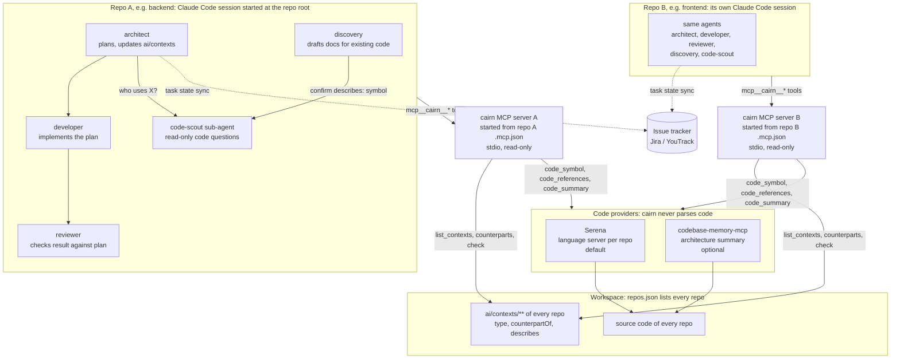

# @stonepandastudio/cairn

Shared AI workflow and project context for a group of repos, so coding agents in any one repo
know the rest.

cairn does two things:

- **A common workflow, kept in sync.** Each repo carries an `ai/` and a `.claude/` folder with
  the same workflow — brief → description → plan → execute → review, run by architect,
  developer and reviewer agents, optionally mirrored into an issue tracker. cairn renders them
  from one set of presets (a stack-agnostic core plus framework, ORM and styling presets),
  reports where copies drift apart, and carries later preset changes into a repo without
  overwriting what it has customized: local additions live in `ai/local/`, everything else is
  three-way merged.
- **Context that spans repos.** The docs under `ai/contexts/` (entities, features, decisions)
  are linked across the workspace, and one MCP server per workspace serves them to agents,
  together with symbol and reference lookups from a third-party code tool (Serena by default).
  An agent in the frontend can ask what the backend's `Staff` entity is, or who calls a
  function. cairn never parses code itself. It is verified on TypeScript/NestJS only.

A cairn is a stack of stones left to mark a trail. That is what this does: it leaves
markers — a manifest of what it generated, a report of where the copies stopped agreeing,
and a map of how the repos connect.

## Start on a new repo (or a group of repos)

A repo with no `ai/` folder yet. For several repos that make up one project, do steps 1–2 in
each, then step 3 once, then step 4. Using Codex? See "Start a Codex-based project" below.

1. **Install and init.** `--stack` is framework first, then add-ons; `cairn preset list`
   shows what exists (`unknown` gives the core agents with no stack rules).
   ```bash
   npm i -D @stonepandastudio/cairn
   npx cairn init --stack nestjs,typeorm --tracker jira-server --project-key MYPROJ --story-type Task
   ```
   Use `--tracker none` for no issue tracker. For `jira-server` / `youtrack`, put the credentials
   in the repo's `.env` (see "Tracker"). Add `--dry-run` first to see what would be written.

   **Which agent host?** `init` records it as `"hosts"` in `cairn.config.json`; the default is
   `["claude"]`. For a Codex project use `--host codex`:
   `npx cairn init --stack nestjs,typeorm --tracker none --host codex`. `render` then writes the
   workflow as Codex skills in `.agents/skills/` and a short root `AGENTS.md` that points Codex at
   `ai/AGENTS.md`. A repo used from both Claude Code and Codex takes `--host claude,codex`; the
   hosts run the same workflow from the same `ai/` docs. For an existing repo, edit `hosts` in `cairn.config.json` by hand (the older
   `"codexSkills": true` still works and means the same as adding `codex`).
2. **Edit `cairn.config.json`** if the defaults need changing: `commands.build`, `tdd`,
   `model`, `agents.<role>.name`.
3. **Group of repos only: declare the workspace.** Create a `repos.json` in the folder that
   holds the repos (or point each repo's `workspace` at it):
   ```bash
   cairn workspace init
   cairn workspace add ./backend --role "REST API, source of truth for the contract"
   cairn workspace add ./frontend
   ```
   `add` reads each repo's stack from its `cairn.config.json`. Once a repo sits in the
   workspace alongside others, its rendered `ai/AGENTS.md` lists the siblings and the agents
   must say which ones a task touches.
4. **Render, review, commit.**
   ```bash
   npx cairn render --dry-run      # what would be written
   npx cairn render
   ```
   Commit `cairn.config.json`, `_cairn/`, `ai/` and `.claude/` (plus `.agents/skills/` and the
   root `AGENTS.md` for Codex). Generated files are committed, not gitignored. Then run
   `/create-brief` in Claude Code, or `$create-brief` in Codex, to start a task.

   For Codex, `cairn context register` also writes the machine-local `cairn` MCP table into
   `.codex/config.toml`; see "Set up code lookups". That file is not committed.

If you add the workspace *after* rendering, run `npx cairn sync` in each repo to carry the
Workspace table in. From the workspace folder, `cairn doctor` reports drift across the repos.

## Start a Codex-based project

The same setup as above, with Codex as the host. Claude Code and Codex run the same workflow
from the same `ai/` docs, so a repo can also serve both (`--host claude,codex`).

1. **Install and init with `--host codex`**, in the repo root:
   ```bash
   npm i -D @stonepandastudio/cairn
   npx cairn init --stack nestjs,typeorm --tracker none --host codex --render
   ```
   `--host` saves `"hosts": ["codex"]` in `cairn.config.json`; `--render` scaffolds right away
   (without it, run `npx cairn render` as the next step). Add `--dry-run` to preview. Tracker
   options are the same as in "Start on a new repo".
2. **What you get**, all committed:
   - `ai/` — role docs, task files, `ai/AGENTS.md` (the same as for Claude Code);
   - `.agents/skills/<step>/SKILL.md` — one Codex skill per workflow step (`create-brief`,
     `enrich-description`, `plan-task`, `execute-plan`, `code-review`, plus `discover`, QA and
     tracker steps where the config enables them);
   - `AGENTS.md` at the repo root — a short pointer that sends Codex to `ai/AGENTS.md` and the
     skills. A repo that already has a root `AGENTS.md` keeps it; add the pointer by hand;
   - `.agents/code-scout.md` — the read-only code-search procedure the skills and role docs refer
     to (a Claude Code repo has it as `.claude/agents/code-scout.md` instead).

   There is no `.claude/` folder: a repo gets Claude Code's files only when `claude` is in `hosts`.
3. **Optional: cross-repo context and code lookups.** Install Serena once per workspace
   (`cairn context setup`, see "Set up code lookups"), then register the server (one command for every host the repo uses):
   ```bash
   npx cairn context register
   ```
   This writes a `[mcp_servers.cairn]` table into `.codex/config.toml`. The file has an
   absolute path in it, so it is specific to this machine: do not commit it, and run the command
   again on each checkout. Skip this step and the skills still work, with plain file search.
4. **Group of repos:** repeat 1–3 in each repo, then `cairn workspace init` / `add` and
   `cairn sync` as in "Start on a new repo". Run `cairn context register` once from the
   workspace folder to register the server in every repo.
5. **Start working.** Open Codex at the repo root (not a subfolder) and run:
   ```
   $create-brief Add CSV export
   ```
   then `$enrich-description`, `$plan-task`, `$execute-plan`, `$code-review`. See "Everyday
   workflow" for the daily loop and "Use the workflow in Codex" for how the skills differ from
   the Claude commands.

Adding Codex to a repo that is already cairn-managed: add `"codex"` to `hosts` in
`cairn.config.json`, run `npx cairn sync` (or `render`), then `cairn context register` if you
want the MCP server.

## Start on a repo that already has code

The code base exists; the AI workflow and its docs do not (or only as hand-copied files).

1. **Install and init**, exactly as above, naming the stack the repo really uses. If there is
   no matching preset, `--stack unknown` still gives the core agents; add the stack's rules
   under `ai/local/` (see "Customizing agent docs").
   ```bash
   npm i -D @stonepandastudio/cairn
   npx cairn init --stack fastify,prisma --tracker none
   ```
2. **Render.** `cairn render` seeds the scaffold and reports existing files it
   leaves in place, such as hand-written `ai/` docs or `.claude/commands/`.
   ```bash
   npx cairn render --dry-run
   npx cairn render
   ```
   - A file cairn skipped because it was already there is **not managed**. To bring it under
     management without losing it, run `cairn sync --adopt-base` (the current file becomes the
     base; upstream changes made before that point cannot be merged). To take the template
     instead, delete the file and run `cairn render`.
   - If the repo already has its own style guide, point `ai/infrastructure/code-guidelines.md`
     (rendered as an editable seed) at it or fold it in.
   - With `codex` in `hosts`, a root `AGENTS.md` the repo already has is kept, not overwritten
     (`render` reports it as "already on disk, not written by cairn"). Add a pointer to it by
     hand: read `ai/AGENTS.md`, and start workflow steps with the `$` skills in `.agents/skills/`.
3. **Draft the context docs.** In Claude Code (or Codex, with `$discover`), inside the repo:
   ```
   /discover            # whole repo
   /discover <area>     # or one area at a time
   ```
   `discovery` reads `ai/contexts/`, proposes a table of docs, waits for you, then writes only
   the confirmed ones as `status: draft` plus `ai/discovery-report.md`. Safe to re-run. Review
   the drafts and change `status` when you accept them. See "Starting on an existing code
   base: `/discover`".
4. **Optional, tests for code that exists:** `/plan-tests`, `/execute-test-plan`, `/run-qa`
   (`$plan-tests`, … in Codex; stacks that ship the QA slots only). See "QA pipeline for
   existing code".
5. **Commit** `cairn.config.json`, `_cairn/`, `ai/` and `.claude/` (and `.agents/skills/`
   with the root `AGENTS.md` if Codex is on).

For a group of repos, do this in each repo, then `cairn workspace init` / `add` as in the
section above and `cairn sync` in each repo. `cairn doctor`, run from the workspace folder,
shows where the copies disagree before you start reconciling them.

## Update cairn in a repo that already has it

`cairn sync` is the upgrade path; it never silently overwrites anything. Edits you want to
keep belong in `ai/local/`, which an update never touches.

**One repo**
```bash
npm i -D @stonepandastudio/cairn@latest     # or yarn / pnpm: update the package
npx cairn sync --dry-run                    # per-file outcome, nothing written
npx cairn sync                              # apply
```
- Exit `3` means a file was left in conflict. Resolve the git markers (`<<<<<<<`), then run
  `cairn sync` again; the second run is a quiet `MODIFIED`.
- A hand-edited agent doc whose template moved is reported with a diff and not touched.
  Move the edit into `ai/local/` (`cairn override extract <agent doc>`), or take the template
  with `cairn sync --reset <path>`.
- On a `0.x` version a pin like `^0.9.0` stops at `0.9.x`; install the new version explicitly
  (`@latest`) or the update is a no-op.
- `cairn sync --only <path>` syncs one file and leaves the rest alone.
- Codex skills and the generated root `AGENTS.md` are managed files like the rest: `sync`
  carries template changes into them and keeps your edits. Turn Codex on later by adding
  `"codex"` to `hosts` and running `sync`.
- Review `git diff`, then commit. Generated files are ordinary tracked files.

**A repo set up with an older cairn (before `hosts`)** needs nothing: a config without `hosts`
means `["claude"]`, which is what it always rendered, so `sync` produces no new files and no
conflicts. To add Codex, add `"hosts": ["claude", "codex"]` to `cairn.config.json` and run
`cairn sync`. A repo that used `"codexSkills": true` keeps working unchanged. `sync`, `render`,
`upgrade` and `cairn doctor` print one line telling you to use `hosts` instead (cairn never
rewrites your config), and the line goes away once you replace the key.

**A group of repos** (from the folder holding `repos.json`)
```bash
cairn doctor                    # versions table: pin / installed / last rendered with
cairn upgrade                   # report only: what would change in each repo
cairn upgrade --apply           # update cairn in each repo, then `cairn sync` there
cairn upgrade --apply --bump-pin   # also rewrite a pin that excludes the new version
```
`upgrade` uses each repo's own package manager (picked from its lockfile), never commits or
pushes, and reports a repo with a blocked pin instead of syncing it with the old version.
Exit `3` means conflicts in some repo, `1` an update failed or was blocked. Afterwards
`cairn doctor --strict` should be clean.

## Set up code lookups (once per workspace)

Optional: everything else works without it. It lets agents in any repo ask about the others
and look up symbols and references.

**One repo only?** Run the same commands from inside it: with no `repos.json` and no
`--config`, that repo alone is the workspace (tools in `<repo>/_cairn/tools/`, and
`register` writes a `.mcp.json` whose server needs no `--config`).

```bash
cairn context setup        # from the folder holding repos.json
```
This installs a version-pinned [Serena](https://github.com/oraios/serena) into
`_cairn/tools/serena/` (a Python 3.11–3.14 venv, about 170 MB, gitignored, never global,
read-only) and gitignores the `.serena/` folder Serena writes into each repo. Serena fronts
the repo's language server, so symbol and reference lookups work for any language it
supports; only TypeScript/NestJS has been measured here. The first lookup in a new
workspace takes about a minute while the language server installs and warms up; `setup`
does that once for you (one throwaway lookup per repo, `--no-warm` to skip), so agents
see fast answers from the start. On Windows keep the workspace path short (under about 125 characters, a pip
limit). `cairn context setup --provider codebase-memory-mcp` adds an optional architecture
summary tool. Then register the MCP server, so agents in any repo can ask about the others:
```bash
cairn context register     # adds a "cairn" entry for each host a repo uses (merge; --force to replace)
```
Claude Code asks you to approve a project server the first time it sees it. The name must stay
`cairn`: the agent docs refer to `mcp__cairn__*`. The entry is
`{ "command": "node", "args": ["node_modules/@stonepandastudio/cairn/bin/cairn.js", "context", "serve", "--config", "../repos.json"], "alwaysLoad": true }`
(`node` + the repo's own installed cairn, so the same file works on Windows, macOS and Linux), with
paths relative to each repo. `alwaysLoad` keeps the six tools out of Claude Code's deferred tool
search, so an agent can call them without loading them first. A repo registered by an earlier
version has the entry without it: `cairn context register --force` updates it. Start Claude Code at the repo root: from a subfolder Claude Code runs
the server from that subfolder and the relative path no longer resolves.

**Codex.** `register` writes an entry for every host a repo names in `hosts` (Claude only, by
default): `.mcp.json` for `claude`, and for `codex` the project-scoped `.codex/config.toml`, as a
`[mcp_servers.cairn]` table (other servers and settings in the file are kept, and a different
`cairn` table is left alone unless `--force`). Codex needs an absolute `cwd`, so that file is
specific to the machine: each checkout runs `register` itself, and the file is not committed
(add `.codex/config.toml` to `.gitignore` if the repo holds only this entry). Codex
reads a project's `.codex/config.toml` once the project is trusted. By hand:

```toml
[mcp_servers.cairn]
command = "node"
cwd = "D:/projects/my-workspace/backend"
args = ["node_modules/@stonepandastudio/cairn/bin/cairn.js", "context", "serve", "--config", "../repos.json"]
```

Adjust the `repos.json` path relative to `cwd`. For a standalone repo without
`repos.json`, omit the final two arguments. Reopen the project in Codex and
check that the `cairn` server is available. In the Codex CLI, use `/mcp` to see
the active servers. As with Claude Code, start Codex at the repo root: the paths in the
entry are relative to `cwd`, and a session started elsewhere will not find the server.
Without the server the skills still work; code lookups fall back to plain file search.

**Existing docs (brownfield, once).** Docs written before cairn have no frontmatter, so
`check` can say nothing about them:
```bash
cairn context adopt                      # dry run: what would be added
cairn context adopt --link-candidates --write
```
This adds `type:` from the category folder and, with `--link-candidates`, `counterpartOf:`
for same-path pairs in another repo (review the pairs first). It only adds frontmatter
lines: bodies and existing keys are never touched, and a second run adds nothing. Then run
`/discover adopt` in each repo: the discovery agent proposes a `describes:` line per doc
(confirming the class with `code_symbol`), you confirm, it writes only those lines.

## How the agents and the MCP server work together

Each repo runs its own Claude Code session. The session starts its own `cairn` MCP server
from the repo's `.mcp.json` (over stdio, nothing listens on a port). A Codex session does the
same from `.codex/config.toml`; the agents and tools below are identical, only the host differs
(Codex reaches the tools by their names under the `cairn` server rather than as `mcp__cairn__*`). The server reads the
workspace's `repos.json`, so an agent in one repo can see the docs and code of all the others.



What each part is for:

| Part | Role |
|---|---|
| architect, developer, reviewer | The task workflow in `ai/agents/`. The architect also keeps `ai/contexts/**` up to date. |
| discovery | Drafts and adopts context docs for code that already exists (`/discover`). |
| code-scout | A read-only sub-agent. The main agent hands it "who uses X" questions. It prefers `code_references` and falls back to Grep when the answer is `unknown`. |
| `cairn` MCP server | Serves context docs and code lookups. It writes nothing. |
| Serena | The default code provider. It runs a language server per repo. |
| codebase-memory-mcp | Optional. Only the `code_summary` architecture overview. |

An answer of `missing`, an empty list or `unknown` is not proof that nothing is there. The
agents are told to read `notes` and to run one Grep before a delete, rename or signature change.

## Everyday workflow

Once the repos are set up (see the sections above), a normal day looks like this. Step 1
applies to a group of repos; the rest apply to any repo.

1. **Check the group is in step.** From the folder holding `repos.json`:
   ```bash
   cairn doctor               # drift between repos, outdated renders, stale installs
   ```
   If cairn itself was updated, follow "Update cairn" above (`cairn upgrade --apply`, or
   `npm i -D …@latest` then `cairn sync` per repo).
2. **Work a task, in the repo it belongs to.** In Claude Code:
   ```
   /create-brief → /enrich-description → /plan-task → /execute-plan → /code-review
   ```
   Fill in the brief yourself; the agents do the rest and stop for your decisions. The plan
   step also updates `ai/contexts/**`. If the task needs a change in a sibling repo,
   `/request-change` files it there through the tracker.

   **In Codex** (repo has `codex` in `hosts`), open Codex at the repo root and use the skill of
   the same name, with the task after it:
   ```
   $create-brief Add CSV export → $enrich-description → $plan-task → $execute-plan → $code-review
   ```
   Same agents, same `ai/` task files, same stops for your decisions. Codex has no separate
   model or agent picker here: it uses the model you started it with, asks in chat where
   Claude would show a picker, and runs the architect → developer → reviewer roles one after
   another where the Claude docs name sub-agents (unless delegation is allowed). Start a fresh
   Codex chat where the docs say to start a fresh session. A repo can mix hosts: tasks
   started in one can be continued in the other, because the state lives in `ai/`, not in the chat.
3. **Let the agent look across repos.** With the MCP server registered, the architect can
   ask `counterparts` for the matching doc in another repo (content included, no checkout
   needed), `code_symbol` whether a type exists there, or `code_summary` for an overview.
   The first question about a repo may take several seconds while it is indexed; later ones
   re-index only if the code changed. Without the tool installed those answers are
   `unknown` with a hint, never an error. In Codex the same lookups need the `cairn` entry in
   `.codex/config.toml` on this machine (`cairn context register`); a fresh clone
   has none until you run it.
4. **Keep the cross-repo docs honest.** When you add or rename a context doc, link its
   counterpart in the other repo and name the code it describes, in the doc's frontmatter
   (`/discover` and the architect's context updates write `describes:` for you when a doc is
   about one named symbol, confirming the name with `code_symbol` when the tool is available):
   ```yaml
   ---
   counterpartOf: frontend:ai/contexts/entities/invoice.md
   describes: entity Invoice
   ---
   ```
   Then, from the workspace folder:
   ```bash
   cairn context check            # CANDIDATE / DANGLING / MISSING_FRONTMATTER / BROKEN_ANCHOR
   cairn context check --no-code  # same, skipping the code lookups (faster)
   ```
   `check` reports and exits `0`; it never fails a build (`--strict` opts in). A
   `CANDIDATE` is a suggestion, not an error: link it, or silence it with
   `notCounterpartOf`.
5. **Commit.** Generated files (including `.agents/skills/` and the root `AGENTS.md`),
   `ai/` and `ai/contexts/` changes are ordinary tracked files. `_cairn/tools/` and
   `_cairn/cache/` are gitignored and never committed; neither is the machine-local `cairn` entry in `.codex/config.toml`.

**Poking at it by hand** (the same calls the agents make):
```bash
cairn context build                          # the context graph
cairn context counterparts backend:ai/contexts/entities/invoice.md
cairn context code symbol backend InvoiceService
cairn context code summary backend
```

## What it does

| Command | |
|---|---|
| `cairn tracker <cmd>` | Issue tracker client (`jira-server` / `youtrack` / `none`). Replaces the copied `ai/scripts/*.js` clients |
| `cairn doctor` | Cross-repo drift report, per-repo generated-file state (incl. `OUTDATED`), and which cairn version each repo pins, has installed, and was last rendered with |
| `cairn init` | Makes a repo cairn-managed: writes `cairn.config.json`, `_cairn/`, and the shim |
| `cairn render` | Scaffolds `ai/` + `.claude/commands/` from the bundled presets, from the repo's stack + workflow |
| `/request-change` | Not a `cairn` subcommand — a slash command `render` adds to repos that share a workspace and a remote tracker. Files a `[target-repo]` issue in the shared tracker project, linked so the requesting task *depends on* it; the target repo adopts it with `/create-brief <key>` |
| `cairn sync` | Re-renders and three-way merges preset changes into a repo that has already rendered |
| `cairn workspace <cmd>` | Manages the repo list in a workspace `repos.json`: `init`, `add <path>` (stack read from the repo's `cairn.config.json`, or `--stack`), `remove <name>`, `list`. Edits only `repos`; the hand-written `shared` / `normalize` blocks stay as they were |
| `cairn upgrade` | Walks the repos in a `repos.json`: updates the installed cairn through each repo's own package manager (npm / yarn / pnpm), then runs `cairn sync` with that version. Report-only unless `--apply`; never commits or pushes. A repo whose pin excludes the running version (`^0.9.0` stops at 0.9.x) is reported as blocked and not synced, unless `--bump-pin` rewrites the pin through the package manager |
| `cairn override <cmd>` | Manages `ai/local/`, a repo's own additions to the generated agent docs: `status`, `extract <agent doc>`, `ack <slot>`. See "Customizing agent docs" |
| `cairn preset list` | The bundled presets — kind (framework / orm / styling), what each ships, and which ones this repo's `stack` uses. `render`, `sync` and `init` also check the stack: a name listed twice or `core` as an entry is refused; a name with no preset (a typo) warns with a suggestion — `cli` and `unknown` are the deliberate exceptions |
| `cairn context <cmd>` | **Prototype.** Resolves `ai/contexts/**/*.md` across a `repos.json` workspace into a graph — declared `counterpartOf` links, inferred reverse edges, and a same-path/same-title suggest pass. `build` / `check` / `counterparts <id>`; `check` never fails CI on its own (`--strict` opts in). `adopt` retrofits frontmatter onto existing docs (`type:`, and with `--link-candidates` `counterpartOf:`; additions only, dry run unless `--write`). `setup` installs a pinned code provider into `<workspace>/_cairn/tools/` — per workspace, never global; Serena by default (symbols + references via the repo's language server), `--provider codebase-memory-mcp` for an optional architecture summary — and `code symbol <repo> <name>` / `code references <repo> <Class/method>` / `code summary <repo>` query it; with a provider, `check` also verifies `describes: entity Foo` anchors (`BROKEN_ANCHOR`). `register` adds the server to each repo's `.mcp.json`; `serve` is an MCP stdio server over all of it (`list_contexts`, `counterparts`, `check`, `code_symbol`, `code_references`, `code_summary`): cairn ships no code parser; without the tool, code answers are `unknown` |

`cairn render` seeds missing files and refreshes managed Codex skills and the
generated root `AGENTS.md` when their contents still match the last render. It
records those writes in the manifest and stores the render in `_cairn/base/`.

`cairn sync` is the upgrade path. For each managed file it holds three versions —
`base` (the last render, in `_cairn/base/`), `ours` (what is on disk), `theirs` (what
the current presets render) — and runs a 2×2:

| | template unchanged | template changed |
|---|---|---|
| **local unchanged** | no-op | fast-forward — write the new render |
| **local changed** | keep local (`MODIFIED`) | three-way merge |

Three cells are automatic. The merge shells out to `git merge-file`; a clean result
is written, a conflicted one is written **with markers** and the command exits
non-zero (`CONFLICT`, a fifth manifest state). Nothing is ever silently overwritten.
Resolve the markers and run `cairn sync` again — the base has already advanced, so
the second run is a quiet `MODIFIED`.

```bash
cairn sync --dry-run          # show the outcome per file, write nothing
cairn sync                    # apply; exit 3 if any file is left in conflict
cairn sync --only <path>      # sync one file, leave the rest (and the version stamp) alone
cairn sync --adopt-base       # for files rendered before _cairn/base/ existed
```

## What lives where

```
repo/
  cairn.config.json     you edit this. cairn only ever reads it.
  _cairn/               cairn writes this. nobody hand-edits it.
    manifest.json       what was generated, from which template, at which hash
    base/               the last render of every managed file — `cairn sync`'s merge base
    scripts/jira.js     vendored tracker shim
  .claude/commands/     rendered from the workflow — one stub per step, plus archive-tasks,
                        fix-review (chains a review's fixes), the tracker-status/assign pair (remote tracker), request-change
                        (shared workspace) and the QA stubs (see below)
  .claude/agents/       code-scout.md — read-only code-locator subagent
  ai/
    agents/             rendered from presets/core + your stack's slots — don't edit,
                        use ai/local/ (architect, developer, reviewer, discovery; plus qa-* if the
                        stack ships the QA slots)
    AGENTS.md  WORKFLOW.md   rendered
    infrastructure/code-guidelines.md   rendered as a seed; edit freely, `cairn sync` merges
    local/              yours: slot and agent overrides — see "Customizing agent docs"
    contexts/  tasks/   yours, never written by cairn
```

`cairn render` seeds the rendered files once and records them in the manifest; it
never rewrites a file you have edited. `cairn sync` is what re-renders later preset
changes over your edits, three-way merging where both moved. The boundary is the
whole design: hand-edited config living inside a generated directory is how
generated directories acquire state nobody dares regenerate.

Generated files are **committed**, not gitignored. Claude Code discovers
`.claude/commands/` and agent docs from disk, and a prompt change should show up in
`git diff` like any other change.

## Workflow and agents

### Use the workflow in Codex

Pass `--host codex` to `cairn init` for a new repo, or add `"codex"` to
`hosts` in `cairn.config.json`, then run `npx cairn render`. Use `npx cairn sync` to merge
local edits with preset changes, or `cairn upgrade --apply` to update and sync
all enabled repos in a workspace. Commit the generated `.agents/skills/`
files with the rest of the scaffold. The same option renders a short root
`AGENTS.md` that points Codex at `ai/AGENTS.md` and the skills; a repo that
already has its own root `AGENTS.md` keeps it — add the pointer by hand.

To use the Cairn MCP server from Codex, run `cairn context register`: it writes the entry for each
host the repo uses (see "Set up code lookups"), and none for a host the repo does not use.

Open Codex in the repo and invoke `$create-brief Add CSV export`. The next
steps are `$enrich-description`, `$plan-task`, `$execute-plan`, and
`$code-review`. Supply the task and step as you would for the Claude
commands. Both hosts use the same role docs and task files in `ai/`.

The skills cover Cairn's built-in commands, including QA and tracker
commands when the repo's configuration enables them. For cross-repo context
and symbol lookups, use the Codex MCP entry in “Set up code lookups.” The
workflow can also run with local file search.

Config keys that shape the rendered agents (all in `cairn.config.json`): `hosts` (agent
hosts to write files for, `["claude"]` by default; add `"codex"` for Codex skills), `model` (reviewer
tier, default `sonnet`), `validationStack` (`zod` default, or `class-validator`; only read
when `nestjs` is in `stack`), `tdd`, `commands.build`, `agents.<role>.name` / `.doc`, and
`workspace` (path to `repos.json`, default `../repos.json`).

Three agents, one step each, rendered from `presets/core` with the stack's slots filled in:

| Step (command) | Agent | Does |
|---|---|---|
| `create_brief` (`/create-brief`) | architect | Scaffolds `brief-step-N.md` for you to fill in. Given a tracker key filed by `/request-change`, seeds it from that issue instead of creating a second parent |
| `enrich_description` (`/enrich-description`) | architect | Discussion, then `description-step-N.md` |
| `plan_task` (`/plan-task`) | architect | `plan-step-N.md` + `ai/contexts/**` updates |
| `execute_plan` (`/execute-plan`) | developer | Implements the plan |
| `code_review` (`/code-review`) | reviewer | Writes `review-step-N.md`; reports only, never edits source |

The architect and developer delegate code search to the `code-scout` subagent
(`.claude/agents/code-scout.md`, Haiku by default; `agents.scout.model` moves it up for a
large or unusual tree).

**Models are recommendations, not gates.** Developer and `qa-developer` recommend Haiku; reviewer, `qa-architect` and the
orchestrator the tier in `model`. Before the first run in a session the agent states the recommendation and the
active model. If the active model is already the recommended tier it just says so and proceeds; otherwise it asks once (an arrow-key + Enter picker): *Continue on the current model? OK / not OK*. OK proceeds for
the rest of the session; not OK stops so you can switch.

**The plan carries tests.** Plans have a **Tests** section: per test file, a table of named
cases the developer writes verbatim, runs file by file, and the reviewer checks exist (the
reviewer never runs them). "Context Docs to Update" is a table with a *When* column
(`now` / `after implementation`), so the developer knows which docs are left for it.

**Re-plans.** If `plan-step-N.md` already exists, `/plan-task` is a re-plan, sent back by a
review's blocking issues or by a developer stop-report. The architect amends the plan
rather than rewriting it, and adds an **Execution Status** section (`Done: steps 1–4.
Resume from: step 5.`) that the developer and reviewer honor.

**Test-first (`tdd: true`).** The architect orders each step's unit test files before the
code and marks every test file `unit` or `integration`. The developer runs each unit file
red (an assertion or missing symbol — not a broken test), then green, and reports
`RED (<reason>) → GREEN (N)`; the reviewer treats a unit file without a red line as a
blocking finding. Default `false`.

**Size check (`sizing`).** Opt-in: `"sizing": { "maxLoc": 400, "maxFiles": 12 }` (`{}` takes
those defaults). During `enrich_description` the architect estimates the step from what it
found — files created and modified, lines from the nearest analogs — states it as a range
with its basis, and, over either limit, proposes a split into smaller steps. The user
decides; the description records a `## Size` section and a `## Follow-up steps` list, and
each follow-up is a `create_brief` away. `plan_task` re-checks the real file list. It is the
agent's estimate, not a measurement.

**Build command.** `commands.build` (e.g. `"yarn build"`) is what the developer runs before
reporting completion; without it the agent finds the command in `package.json` or the README.

### Starting on an existing code base: `/discover`

`/discover [area]` runs the `discovery` agent, which drafts `ai/contexts/**` from the code.
Run it once before the first task on a repo whose contexts are empty or thin. It proposes a
table of docs and waits for you, then writes only the confirmed ones, as
`ai/contexts/<category>/<name>.md` with `type`, `source` and `status: draft` frontmatter (the
layout `cairn context check` expects), plus `ai/discovery-report.md`.

**Safe to re-run.** It reads what is already in `ai/contexts/` first and adds only what is
missing: it never overwrites, renames or edits an existing doc, even one on the wrong path
or without frontmatter. Such docs are listed in the report under *Needs a human*. It is
read-only on source and delegates searching to `code-scout`.

What counts as a doc comes from each stack's `discover-targets` slot (TypeORM and Drizzle
entities, Nest modules, Angular and React pages and features, Next.js routes and server
actions). A stack without one still gets the command, with an empty list. Not yet built:
`cairn context adopt`, which would move existing off-convention docs onto the layout.

### QA pipeline for existing code

Separate from the workflow: `/plan-tests [task] [target]`, `/execute-test-plan [task] [target]`
and `/run-qa [task] [target|all]` add tests to code that already exists, via `qa-architect`,
`qa-developer` and `qa-orchestrator`. They are a core contract; a framework preset opts in
by shipping seven `qa-*` slots (`qa-target`, `qa-source`, `qa-plan-rules`, `qa-plan-format`,
`qa-write-steps`, `qa-all-targets`, `qa-mandatory-docs`). `nestjs` fills them for Jest,
`angular` for Playwright e2e; `react` and `nextjs` get no QA agents. Agent names default to
the primary stack (`NestjsQAArchitectAgent`) and can be set with `agents.qaArchitect.name`,
`qaDeveloper`, `qaOrchestrator`. Test-first does not apply here: there is nothing to go red
against. See `presets/README.md` § QA.

> Migrating: the old `/add-e2e-tests` command and `ai/agents/qa.md` (angular) are gone,
> replaced by the pipeline above. Run `cairn sync`; delete the leftover files if you no
> longer want them.

## Tracker

```bash
cairn tracker list-statuses MYPROJ
cairn tracker create-task "Some task title"
cairn tracker create-subtask MYPROJ-101 "Step 1: first slice"
cairn tracker set-status MYPROJ-102 "In Progress"
cairn tracker append-description MYPROJ-101 ./ai/tasks/MYPROJ-101/brief-step-1.md --markup
cairn tracker close-story MYPROJ-42          # cascades through subtasks first
```

The rest of the surface:

| Command | |
|---|---|
| `list-projects [--json]` | `KEY - Name` per project the credentials can see |
| `get <key>` | The issue as JSON; adds `epic` and `ref` only when there is one |
| `set-fields <key> [--summary ..] [--description ..] [--description-file ..]` | Replaces the named fields; unnamed ones are left alone. Contrast `append-description`, which adds to the end |
| `set-assignee <key> <username>` | Assigns the issue |
| `link <key> <dependsOnKey>` | `key` *depends on* the other issue. **YouTrack only**: Jira Server throws "not implemented", `none` skips. `/request-change` uses it, and on Jira Server falls back to `append-description` notes on both issues |
| `resolve <ref>` | Prints the tracker key behind a public ref (`CI-1-4` → `CI-79`) |
| `check-statuses` / `check-refs` | See "Moving issues between stages" and "Epics and public refs" |

`--markup` (convert markdown to Jira wiki markup) applies to any command that takes
description text, and `--json` where a command supports it. Anywhere a key is taken, a
public ref works too.

Providers are `jira-server`, `youtrack` and `none`, chosen per repo via
`tracker.provider`. `none` is a real provider, not an error case: a repo with no
tracker makes the workflow steps no-ops rather than every command stub needing an
"if this repo has a tracker" branch written in prose. YouTrack has no Task/Sub-task
type split (a `Subtask` link instead), a `Stage` state field rather than a
transition graph, and markdown-native descriptions.

Three things the copied scripts did that this does not:

- **`process.exit` from library code.** Failures throw `TrackerError`; the CLI layer
  chooses the exit code. That is what makes the client callable from a workflow runner.
- **Fail on a re-run.** Transitioning to a status the issue already holds is a
  successful no-op. `NoTransitionError` exits 0 — re-running a step must be safe.
- **Ask an agent to convert markup by hand.** `ai/JIRA_MARKUP.md` was a prose document
  explaining markdown → Jira wiki conversion. It is `toMarkup()` now, under test,
  reachable via `--markup`.

Credentials come from the repo's `.env` — `JIRA_BASE_URL` / `JIRA_USER` /
`JIRA_PASSWORD` for `jira-server` (Basic auth: Jira Server 8.5.1 predates PATs), or
`YOUTRACK_URL` / `YOUTRACK_TOKEN` / `YOUTRACK_PROJECT` for `youtrack` (Bearer token,
admin-read scope for the project and stage-bundle lookups). Anything already in the
environment wins over the file. If the repo's own app reads those same names, set
`tracker.envPrefix` (`cairn init --env-prefix CAIRN_`) so cairn reads
`CAIRN_YOUTRACK_TOKEN` instead — or point `tracker.env` at a separate file.

### Moving issues between stages

Two workflow steps can move the issue, and only if the repo names the stage:

```json
"tracker": { "provider": "youtrack", "projectKey": "CI",
  "statuses": { "inProgress": "Develop", "review": "Review" } }
```

- `enrich_description` moves the step's issue (and its parent, for a child issue) to `inProgress` once the description is written and the digest posted (the architect's A.5).
- `code_review` moves it to `review` **at the start** of the review (R.0). The verdict never changes the stage; later moves stay manual.
- Nothing moves without the key: cairn's defaults (`To Do` / `In Progress` / `Done`) are not a promise your board has them. Run `cairn tracker check-statuses` to compare the configured names with the board; `list-statuses` shows the board's.

**A stage the board does not have is skipped, not fatal.** The agents run `cairn tracker set-status <key> "<stage>" --if-exists`. If the board has no such stage the command prints `skipped: stage "Review" does not exist on this board, so CI-5 was not moved. Valid stages: …` and exits 0; the agent mentions it once and carries on, and never substitutes another stage. Without `--if-exists` the same call fails (exit 1) and names the valid stages. On Jira, a stage that exists but cannot be reached from the issue's current state is still the old "no transition" message (exit 0): only a stage the project never defined counts as missing.

### What goes to the tracker

The tracker is an index for people scanning a board; `ai/tasks/[KEY]/` is the source of
truth and the sync is one-way, so agents post a **digest**, never the step file:

- `create_brief` — title, 2–3 sentences of what and why, and the brief's path.
- `enrich_description` — under ~600 characters: the outcome, at most 5 one-line decisions,
  and the description's path. No tables, file lists or code.
- `plan_task` — no tracker sync; nothing from the plan is posted.
- `/request-change` is the exception: the receiving repo has no local copy, so its issue
  carries the full What / Why / Acceptance.

**Step 1 is the parent issue itself.** A one-step task is one issue; steps 2+ get a child
issue under it, and a step marker equal to the folder key means "do this step's tracker
actions once, on the parent". Nothing is split off when a task grows a second step.

### Epics and public refs (both optional)

Nothing here changes a repo that doesn't use it: no config, no extra requests, and
`get` prints the same JSON as before.

```bash
cairn tracker create-epic "Onboarding rework"
cairn tracker create-story "Invite flow" ./brief.md --epic MYPROJ-50
cairn tracker set-epic MYPROJ-61 MYPROJ-50      # or `none` to detach
cairn tracker epic-children MYPROJ-50
cairn tracker close-epic MYPROJ-50              # refuses while stories are open; --force cascades
```

Jira Server stores the link in the "Epic Link" custom field (id differs per instance,
looked up by name the first time an epic command needs it; set `tracker.epicLinkField`
to skip the lookup and let `get` report `epic`). YouTrack uses Type = Epic and the same
`Subtask` link stories use for their subtasks. `none` skips every epic command.

**Public refs** (`tracker.publicRefs: true`): the tracker's own key stays the internal
one (`CI-79`); epics also get `CI-E1` and stories created or moved under an epic get
`CI-<epic>-<n>` (`CI-1-4` = story 4 of epic 1). The ref is a `ref-CI-1-4` label (Jira)
or tag (YouTrack), so it is searchable in the tracker and needs no custom field. Every
tracker command accepts either form (`cairn tracker get CI-1-4`). Rules:

- Steps get refs too. `CI-1-4.2` is step 2 of story 4 in epic 1; step 1 is the story
  itself, so `CI-1-4.1` resolves to `CI-1-4`. To add a step by ref:

  ```bash
  cairn tracker create-step CI-1-4 "Add the rollback path" ./brief-step-2.md          # next free number
  cairn tracker create-step CI-1-4 "Add the rollback path" ./brief-step-2.md --step 2 # match brief-step-2.md
  ```

  Pass `--step` to keep the ref in line with the workflow's `brief-step-N` file. A number
  a sibling step already holds is refused; step numbers start at 2.
- Refs are immutable: a story moved to another epic keeps the ref it was born with.
- Only new issues are numbered. An epic created before `publicRefs` has no ref, and
  stories added to it get none.
- Numbers are max+1, so two people creating at the same moment can collide.
  `cairn tracker check-refs` lists any ref carried by more than one issue; nothing is
  renumbered automatically, since refs get quoted in commits.
- The ref is printed on stderr (`public ref: CI-1-4`); stdout stays the bare tracker key.

### Legacy command names

`create-task`, `create-story`, `close-story` and friends are all still accepted, and
output formats are byte-for-byte what the old scripts printed. Existing prose
references name these strings and the agents parse the output, so they are kept
until a render pass regenerates those documents from the presets.

## Customizing agent docs: `ai/local/`

`ai/agents/*.md` are generated. Don't edit them: a project's changes live next to them
in `ai/local/`, which cairn reads and never writes, and `cairn sync` rebuilds the agent
from the template plus those files. There is nothing to merge, so a template update
can't conflict with your edits.

```
ai/local/
├── slots/<slot>.md      change one stack slot (implementation-reference, review-checklist, …)
└── agents/<name>.md     add to the end of one agent doc
```

**A slot file holds only the sections that differ.** A heading the preset also has
replaces that section (and anything nested under it); every section the file doesn't
mention keeps following the preset.

```markdown
<!-- ai/local/slots/implementation-reference.md -->

### Controllers
- Bind inputs with `@Body({ schema })`, `@Param({ schema })`, `@Query({ schema })`
- Return the response DTO class; there is no `@ZodResponse`

### Billing
- Money is integer minor units. Use `Ledger`, never a raw repository.

### Testing
<!-- remove -->
```

- `### Controllers` replaces the preset's Controllers section.
- `### Billing` isn't in the preset, so it is added at the end of the slot.
- `<!-- remove -->` as a section's body deletes that section.
- A file with no headings is appended to the slot. A first line `<!-- replace -->` makes
  the file the whole slot; that is the one form where you restate the preset's text.
- The `architect-mandatory-docs` slot is now `mandatory-docs`, because the developer and
  reviewer read the same list. An `ai/local/slots/architect-mandatory-docs.md` still
  applies, but rename it; `cairn override status` flags the old name.
- Headings inside code fences are text. Other leading `<!-- … -->` comments are yours and
  are dropped. The files are templates, so `{{ tracker.exampleKey }}` and friends work.

`ai/local/agents/<name>.md` is appended to `ai/agents/<name>.md` under a "Project-specific"
heading, for rules that belong to no slot. `key-patterns` feeds both the architect and the
developer, so overriding it changes both.

```bash
cairn sync                                   # rebuilds the agents from template + ai/local
cairn override status                        # what is in ai/local, and what needs a look
cairn override extract ai/agents/developer.md   # turn a hand-edited agent doc into overrides
cairn sync --reset ai/agents/developer.md    # then take the generated file
cairn override ack implementation-reference  # "I've reviewed the preset's change"
```

**If an agent doc was edited by hand** while the template moved, `cairn sync` leaves it
alone, prints your edit as a diff, and exits 3. `cairn override extract` writes that diff
out as override files (only the changed sections), checks that they reproduce your edit,
and leaves what it can't place for you to decide. Then `--reset` takes the generated file.
If the template didn't move, a hand edit is only noted.

**Staying current.** An override replaces a section for good, so the preset's later
improvements to it won't reach you. Sync records each override the first time it sees it
and says so when the preset's slot changes underneath it, or when a section you replaced
no longer exists in the preset (it would otherwise be added as a second section).
`cairn doctor` lists the same warnings across the workspace; `cairn override ack` clears
one once you've looked.

Only agent docs work this way. Command stubs, `WORKFLOW.md`, `AGENTS.md` and
`code-guidelines.md` keep the three-way merge on `cairn sync`, since they have no
`ai/local/` hook.

## Doctor

```bash
cairn doctor                                     # full table
cairn doctor --diff ai/WORKFLOW.md               # hunks for one file across repos
cairn doctor --json
cairn doctor --normalize-issue-type              # also fold Story/Task issue-type wording together
cairn doctor --strict                            # exit 1 on drift or a hand-edited generated file
```

Run it from the directory holding `repos.json`, or pass `--config <file>`.

It reports two independent axes, and keeping them apart is the point:

**Drift** — cross-repo. Do the copies still agree? Raw comparison is noise, so each
file is normalized first: BOM and CRLF stripped, repo paths and names folded, issue
keys folded to `{{ISSUE}}`, and declared vars folded to `{{placeholder}}`. What
survives is drift no template variable explains. Files are then clustered by
normalized content; the largest cluster becomes the reference.

| Status | Meaning |
|---|---|
| `IDENTICAL` | byte-identical everywhere |
| `COSMETIC` | differs only in declared vars — extract as a template, zero merge cost |
| `DRIFT` | two or more genuinely different variants, with a similarity score |
| `MISSING` | some repos in the cohort lack it |
| `STRANDED` | exactly one repo has it — promotion candidate |

**Managed** — per-repo, read from `_cairn/manifest.json`. Does what cairn wrote still
match what is on disk?

| State | Meaning |
|---|---|
| `MANAGED` | on-disk hash matches what cairn wrote |
| `MODIFIED` | someone hand-edited a generated file |
| `OUTDATED` | cairn has newer content for it — needs template hashes threaded through |
| `DELETED` | it is gone; `cairn sync` restores it from the current render |
| `CONFLICT` | `cairn sync` left git merge markers in it — resolve, then sync again |

The doctor reports all five. `OUTDATED` means the current presets render something
different from the last render stored in `_cairn/base/` — `cairn sync` would move it.
A `MODIFIED` file whose template also moved stays `MODIFIED`. Acting on drift between
the render and the working tree is `cairn sync`.

A separate **cairn versions** table lists, per repo, the `package.json` pin, the version
in `node_modules`, and the cairn that last wrote `_cairn/manifest.json`. It flags a repo
whose install is behind the running cairn, one whose files were rendered by an older cairn
than it now has installed (update done, `cairn sync` not), and one whose cairn is a link
to a checkout rather than a published version. Not part of `--strict`.

A file can be perfectly in sync across repos while being hand-edited away from its
template, and vice versa. `MODIFIED` outranks `OUTDATED` in the report because
overwriting a hand edit is the destructive outcome.

### Workspace config (`repos.json`)

- `repos[]` — name, path, stack (`"angular"` or a list `["nestjs", "typeorm"]` —
  framework first), and an optional one-line `role` (`"REST API, source of truth for the
  contract"`). Per-repo settings live in each repo's own `cairn.config.json`;
  the inline `vars` blocks are a fallback used only until a repo has been through
  `cairn init`, so migration can happen one repo at a time.
- **The workspace reaches the agents too.** `cairn render` / `cairn sync` look for this
  file at `../repos.json` (or `workspace` in the repo's `cairn.config.json`). If the repo
  is listed in it alongside others, the rendered `ai/AGENTS.md` gains a **Workspace**
  table (sibling name, relative path, stack, `role`), and the architect's mandatory
  checklist and description format require it to name which siblings the task touches.
  Without this, a repo's agents know nothing of the other repos in the project. Adding a
  repo or a `role` changes the render; `cairn sync` carries it in.
- `pathAliases` — local → canonical. When one repo names a stub `execute-tests.md`
  where the others use `execute-test-plan.md`, aliasing folds them onto the cohort's
  names instead of reporting one `MISSING` and one `STRANDED` for the same file.
- `shared[]` — glob rules. `cohort: "all"` compares every repo; `cohort: "stack"`
  groups by the first stack entry (all `nestjs` repos together, whatever the ORM).
  `requires: { tracker: true }` skips repos with no tracker. A repo with no config
  has an *unknown* tracker, not an absent one, and is never skipped on that basis.
- Anything not matched by a rule — `ai/contexts/`, `ai/progress/`, `ai/tasks/`,
  `DATABASE_SCHEMA.md` — is per-project by design and never inspected.
  `ai/INITIAL_PROMPT.md` is explicitly excluded: variants at ~0% shared content make
  it a per-project document, not a drifted template.

A later release splits this flat file into a per-project `workspace.json` plus an
opt-in hub that references the projects for cross-project comparison. See `DESIGN.md`.

## Layout

```
bin/cairn.js           subcommand router
lib/config.js          cairn.config.json + .env loading
lib/workspace.js       sibling repos from repos.json, for the renderer
lib/presets.js         preset catalogue + stack validation; lib/preset/ is `cairn preset`
lib/manifest.js        generated-file hashing and state
lib/paint.js           ANSI + table rendering
lib/tracker/           index (registry), cli, jira-server, youtrack, none
lib/doctor/            index (analysis + report), scan, normalize, diff, versions
lib/render/            engine (a small template engine), index (driver), cli
lib/sync/              index (the 2x2 + git merge-file, outdatedRels), cli
lib/local/             ai/local/ reader: slot and agent overrides; extract, inspect
lib/override/          cairn override
lib/upgrade/           cairn upgrade — update + sync across a workspace
lib/workspace/         cairn workspace (lib/workspace.js is the renderer-side reader)
lib/context/           cairn context (prototype)
lib/init.js            cairn init
templates/shims/       vendored shim source
presets/               core/ + framework/ORM/styling presets rendered by `cairn render`
schema.json            JSON Schema for cairn.config.json
test/run.js            dependency-free test runner
```

No runtime dependencies (`cairn sync` shells out to `git`). Node >= 18. `npm test`
runs the whole suite, including snapshot tests: every file the presets render for six
representative stacks is committed under `test/snapshots/`, so a template change shows up as
a diff. After an intended change, `UPDATE_SNAPSHOTS=1 npm test` and review `git diff test/snapshots`.
